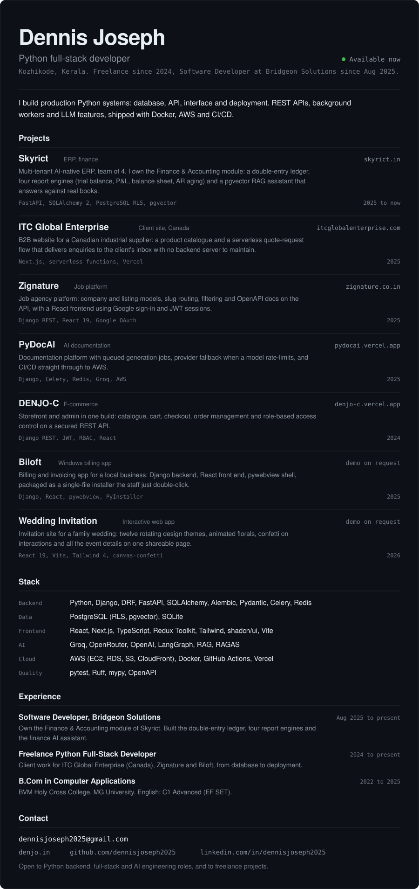

  

  <a href="https://skyrict.in/">Skyrict</a> ·
  <a href="https://www.itcglobalenterprise.com/">ITC Global Enterprise</a> ·
  <a href="https://www.zignature.co.in/">Zignature</a> ·
  <a href="https://pydocai.vercel.app">PyDocAI</a> ·
  <a href="https://denjo-c.vercel.app">DENJO-C</a>

  <a href="https://denjo.in/">Portfolio</a> ·
  <a href="https://github.com/dennisjoseph2025">GitHub</a> ·
  <a href="https://www.linkedin.com/in/dennisjoseph2025/">LinkedIn</a> ·
  <a href="mailto:dennisjoseph2025@gmail.com">Email</a>

